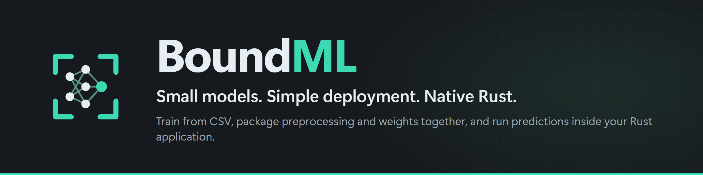

<p align="center">
  
</p>

**BoundML** trains small dense models from CSV and ships them as one checked
package: feature schema, fitted preprocessing, weights, self-tests and a planned
tensor-memory budget. You load that package inside your Rust application and predict
with no Python, no ML framework and no network.

It is for Rust developers who embed **small numerical prediction models** in an
application or local service: linear/logistic regression and small MLPs on tabular
features. CPU only. **Early release (0.1.0).** [What is verified](docs/release-status.md)

[](#license)

<p align="center">
  
</p>
<sub>Recorded from the real binary by <code>scripts/record_demo.py</code>. Command typing speed is synthetic and pauses are capped at 1.2 s; output is unedited (<a href="assets/demo-transcript.txt">transcript</a>, <a href="assets/demo.cast">asciinema cast</a>).</sub>

## Install

**Recommended:** download the archive for your platform from this repository's
[Releases](../../releases) page, check its `.sha256`, extract it, and run `boundml`
from the extracted folder. It is one executable with no dependencies. Windows x86_64
archives are smoke-tested; Linux/macOS archives come from the release workflow, which
has not run yet. Commands for PowerShell and bash, plus update and removal steps, are
in [docs/install.md](docs/install.md).

From a checkout instead (Rust 1.94+): `cargo install --path crates/boundml-cli --locked`.

The commands below are written as `boundml …`. In **PowerShell**, from the extracted
folder, type `.\boundml …` instead, or add the folder to `PATH` as shown in
[docs/install.md](docs/install.md).

```bash
boundml --version
```
```text
boundml 0.1.0 (revision 1f4146b7fe, x86_64-pc-windows-msvc)
```
The revision (source commit) and target in parentheses identify your build and will differ.

## Quickstart: CSV → model → prediction

`boundml init` writes a config and a small synthetic CSV dataset (power use from
temperature, humidity and load; about 2% of humidity values are left blank to
exercise imputation). Nothing is downloaded.

```bash
boundml init demo
boundml train demo/model.toml --checkpoint demo/ckpt --quiet
boundml evaluate demo/ckpt --data demo/data/test.csv
```
```text
training complete after 1890 steps in 0.16s; checkpoint: demo/ckpt
final epoch: train_loss=0.03957  valid: mae=0.1527 mse=0.0366 r2=0.9954 rmse=0.1913
metrics on demo/data/test.csv:
  mae            0.1465   (constant baseline 2.2394)
  mse            0.0352   (constant baseline 11.0583)
  r2             0.9968   (constant baseline -0.0071)
  rmse           0.1877   (constant baseline 3.3254)
  rows         400.0000   (constant baseline 400.0000)
```

The model predicts `power` with an RMSE of 0.19 on held-out rows. Predicting the
training mean for every row, the "constant baseline", gives 3.33.

```bash
boundml pack demo/ckpt --out demo/model.boundml
boundml predict demo/model.boundml --data demo/data/test.csv --out demo/pred.csv --preview 3
```
```text
packed 'example-regression' -> demo/model.boundml (17 synthetic self-test vectors, verified after write)
wrote 400 predictions to demo/pred.csv in 0.001s
  line   power
     2  4.5001
     3  6.3667
     4  7.7849
```

Each prediction is the model's estimate of `power` for one CSV row. `line` is the
row's line number in the input file. The package applied the preprocessing fitted
during training (standardization; mean imputation for the blank humidity cells), so
the rows go in raw.

**When it doesn't fit**, BoundML says so before allocating anything:

```bash
boundml plan demo/model.toml --mode infer --tensor-budget 64KiB
```
```text
error: BML-C005 tensor budget exceeded: plan needs 68228 bytes but the budget is 65536 bytes; largest contributors: arena x 2 session(s) (65536 bytes), shared weights (2692 bytes), dense0.act (16384 bytes), dense0.matmul (16384 bytes), dense0.pre (16384 bytes)
```

Exit code 4. Fix it by lowering `deploy.max_batch` (128 → 64 fits) or
`deploy.sessions` in `demo/model.toml`, or by raising the budget. Every error code and its correction is
in [docs/errors.md](docs/errors.md). Full walkthrough with real datasets:
[docs/quickstart.md](docs/quickstart.md).

## Embed it in a Rust application

```toml
[dependencies]
boundml-artifact = { path = "crates/boundml-artifact" }   # not yet on crates.io
```

```rust
use boundml_artifact::Package;
use std::sync::Arc;

fn main() -> Result<(), boundml_artifact::ArtifactError> {
    // Integrity, format version, graph rules and the memory plan are checked here.
    let package = Arc::new(Package::load("demo/model.boundml".as_ref())?);
    let mut predictor = package.predictor(1)?;            // one per worker thread

    let mut raw = vec![None; predictor.n_features()];     // features by name; None = missing
    predictor.fill_named([("temperature", Some(20.0)), ("humidity", None), ("load", Some(0.5))], &mut raw, 0)?;
    let mut out = [0.0f32; 1];
    predictor.predict_raw(&raw, 1, &mut out)?;            // preprocessing + model, no heap allocation
    println!("power = {}", out[0]);
    Ok(())
}
```

Runnable versions: [`examples/embed`](examples/embed/src/main.rs) (from a checkout:
`cargo run -p boundml-embed-example -- <path to>/demo/model.boundml temperature=20 humidity= load=0.5`) and
[`train_and_embed`](crates/boundml-train/examples/train_and_embed.rs), which trains
from Rust code.

## Where it is useful

- **A desktop or CLI tool that estimates something locally**, such as energy use,
  a risk score or a wait time from a handful of numeric inputs. Ship one Rust binary
  plus a small package directory, with no Python runtime to bundle.
- **A Linux gateway or local service that scores readings** under a fixed memory
  budget. `boundml plan` and package loading reject configurations whose planned
  tensor memory exceeds the declared budget, and prediction allocates nothing per call.
- **A team that retrains regularly** and wants CI to stop incompatible updates.
  `boundml compare current.boundml candidate.boundml --data holdout.csv` exits 6 on
  breaking changes: renamed or removed features under a strict schema, changed
  classes, a smaller `max_batch`, a larger memory plan, or output drift beyond a
  threshold.

## How it works

<p align="center"></p>

The package is a plain directory (`manifest.json`, `MANIFEST.sha256`,
`weights.safetensors`) with no executable code. On load, the runtime re-validates
everything and **recomputes** the memory plan rather than trusting the file.
Checksums detect corruption; they do not prove who made the package. Details:
[architecture](docs/architecture.md) · [package format](docs/package-format.md).

## Compared with alternatives

| If you need… | Consider | Why BoundML might still fit |
|---|---|---|
| Large or GPU models, many layer types | PyTorch, Burn, Candle | It doesn't; BoundML is deliberately small |
| Fastest CPU inference of an ONNX model in Rust | tract, ONNX Runtime | They have faster batch kernels (below). BoundML adds the bundled schema/preprocessing/self-test/memory contract and trains natively |
| Classical ML (trees, SVMs, clustering) in Rust | Linfa, SmartCore, Aprender | BoundML has dense models only; it adds packaging with preprocessing and compatibility checks |
| Memory-planned mobile deployment of PyTorch models | ExecuTorch | BoundML targets Rust applications and tabular inputs with no Python in the workflow |

Research notes with sources: [docs/research.md](docs/research.md).

## Evidence

One machine (Ryzen 7 8700F, Windows 11), the same weights in every runtime, five
runs each. Full tables, methodology and raw JSON: [docs/benchmarks.md](docs/benchmarks.md).

<!-- README-BENCH:BEGIN -->
| 30-feature MLP, breast-cancer data | BoundML | tract (Rust) | ONNX Runtime (Python) | PyTorch (Python) |
|---|---|---|---|---|
| Process start → first prediction | **9.1 ms** | 11.2 ms | 211.9 ms | 1.49 s |
| Peak process working set | **6.3 MiB** | 9.5 MiB | 51.4 MiB | 202.4 MiB |
| 1-row latency, p50, incl. preprocessing | **0.3 µs** | 1.7 µs | 9.9 µs | 27.5 µs |
| Batch-256 throughput, model only | 8.8 M rows/s | **28.8 M rows/s** | 17.6 M rows/s | 6.0 M rows/s |
| Batch-256 throughput, incl. preprocessing | 7.1 M rows/s | **15.6 M rows/s** | 10.0 M rows/s | 4.1 M rows/s |
<!-- README-BENCH:END -->

**tract and ONNX Runtime are faster on large batches.** BoundML's kernels are simple
and single-threaded. It is ahead on start-up, memory and single-row calls, and the
Python numbers include interpreter overhead. Trained-model quality matches PyTorch
on both datasets (Burn reached a lower RMSE on wine), and the MLP did not beat linear
models on either
([walkthroughs](docs/walkthroughs.md)). The memory guarantee covers **planned tensor
storage** for a declared batch size and session count, not whole-process memory.

## Supported in 0.1

| | |
|---|---|
| Models | linear regression, logistic/softmax regression, MLPs with ReLU/Tanh/Sigmoid |
| Tasks | regression (1 target), binary, multiclass |
| Data | numeric CSV columns mapped by name; standardization; mean imputation or reject |
| Training | SGD (momentum, L2), AdamW, minibatches, exact checkpoint/resume |
| Run | Rust `Predictor` API, `boundml predict`, local HTTP (`boundml serve`, no auth/TLS) |
| Import | dense PyTorch `nn.Sequential` / Keras `Sequential`, checked against the source framework ([migrate/](migrate/README.md)) |
| Platforms | Windows x86_64 built and tested; Linux x86_64 and macOS arm64 configured in CI, **not yet observed** |
| Not supported | GPU, CNN/RNN/transformers, trees, categorical features, arbitrary ONNX, wasm/no_std |

## Documentation

[Quickstart](docs/quickstart.md) · [Install](docs/install.md) ·
[Troubleshooting](docs/troubleshooting.md) · [Errors](docs/errors.md) ·
[Walkthroughs (real data)](docs/walkthroughs.md) · [Architecture](docs/architecture.md) ·
[Package format & compatibility](docs/package-format.md) · [Data policy](docs/data.md) ·
[Benchmarks](docs/benchmarks.md) · [Release status](docs/release-status.md) ·
[Roadmap](ROADMAP.md) · [Changelog](CHANGELOG.md)

Contributing: [CONTRIBUTING.md](CONTRIBUTING.md) · [Code of conduct](CODE_OF_CONDUCT.md) ·
[Support](SUPPORT.md) · [Security](SECURITY.md). Tried it on a real workload? A
*Workload report* issue is the most useful feedback right now.

## License

Licensed under either of [MIT](LICENSE-MIT) or [Apache-2.0](LICENSE-APACHE), at
your option. Third-party notices: [THIRD_PARTY.md](THIRD_PARTY.md). Demo data: UCI
Machine Learning Repository, CC BY 4.0 ([datasets/README.md](datasets/README.md)).
